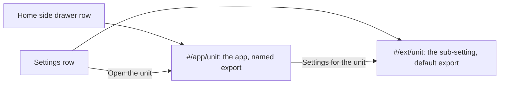

<!-- describes: backend/pkg/extension/app.go backend/tools/gen-composition/astreader_app.go frontend/src/lib/extensionapps.ts frontend/src/app/nav.ts -->
# Why a unit may have a drawer entry

A unit may declare one app, and the home side drawer then lists it with the unit's own icon and name. This page
says why the drawer is open to a unit, and what stops that from costing the product its own list of destinations.
It is for anyone who reviews a unit or changes the drawer. To declare an app, go to
[how-to/add-an-extension.md](../how-to/add-an-extension.md#show-an-app-in-the-home-side-drawer).

## The decision

The drawer lists the product's own destinations first. Then it lists the apps that enabled units declare. The
drawer once kept every composed unit out. The thought was that enabling a unit should not grow the list every
contact sees, so a unit was offered only under Settings. That rule is lifted for a unit that declares an app.

A connector is a place members work in, not only a place an admin sets up. A row that an admin alone finds under
Settings hides it from the members who use it.

## What keeps the old worry in check

| Limit | How it holds |
|---|---|
| The core draws the row | The unit names the icon, the words, one of the three headings the drawer has and its component. It cannot restyle the drawer or add a heading |
| The row follows the grant | The unit names an RBAC object. A role without `read` on it sees no row, and `#/app/<unit>` answers the unknown-page card |
| The product's rows do not move | App rows come after the product's rows in their group. A unit that declares no app adds nothing |
| The icon list is short | The icon is one of the entry icons. A test fails when the Go list and the TypeScript list differ |

## Two addresses, two jobs

The sub-setting at `#/ext/<unit>` is unchanged. It keeps the default export and its place under Settings. Each
address links to the other.
