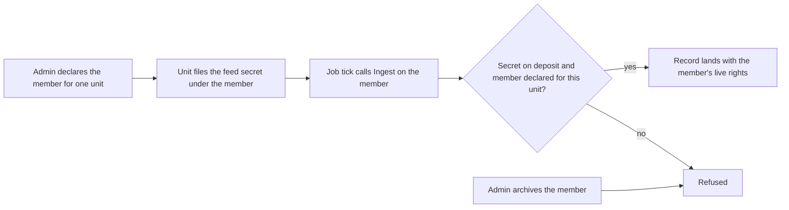

# Declare a service member for an unattended feed

A service member is a member of the installation that no human signs in as. An extension's scheduled feed lands records as this member, so the feed does not stop when a colleague leaves. This page is for an installation admin who sets a feed up. It is also for an extension author who wants to know what the feed will run as.
The core makes the member at boot for each installed extension that lands companies or deals. An extension that lands only activities runs as the colleague who opened its endpoint, so it gets none.


## Why a feed needs one

A feed that polls on a schedule lands records as a member, and it keeps that member's secret. If the member is a colleague, two things go wrong over time:

- The feed stops the day the colleague is deactivated or archived.
- The colleague's secret goes with their account if the account is ever deleted.

A service member has neither problem. It is not a human, so there is nobody to offboard.

## What a service member is

| Property | What it means |
|---|---|
| Login | None. It has no password, and the sign-in route refuses it. |
| Seat | A full seat type, but free of the licence seat limit. It is not counted, and declaring one never fails on the seat limit. |
| Role | `service_ingest`: create, read and update on activities, contacts, companies and deals, plus the read of installation settings that pricing a deal needs. No delete anywhere. A role seeded before deals were landable gets the deal grant from a migration, unless an admin edited it by hand. See [land-companies-and-deals-from-an-extension.md](land-companies-and-deals-from-an-extension.md). |
| Lifetime | Archived by an admin, never deleted. The database refuses a delete. |
| Who may use it | Only the extension it was declared for. Any other extension is refused. |
| Who may change it | Only an installation admin. A delegated member administrator cannot deactivate, re-role or archive it. |

Service members are free of the licence seat limit because unattended feeds need them. The seat meter skips them, like any other non-human member.

## Declare one

Only an installation admin signed in with a session can do this. An agent passport is refused.

```sh
curl -X POST http://localhost:8080/v1/users/service-members \
  --cookie 'crm_session=<your session>' \
  -H 'Content-Type: application/json' \
  -d '{"extension": "relay", "display_name": "Relay feed"}'
```

`extension` is the manifest name of the unit, up to 64 characters. Check the spelling. A name that no installed unit carries is accepted and is never used. `display_name` is up to 255 characters.

The answer is the new member. Keep its `id`.

The call is refused with `409` and the code `company_not_described` until the installation has saved its own company with `PUT /company`. Save the company first, then declare the member.

## Let the feed run as it

The extension files the feed's secret under the service member with `PutUser`, in a screen or a tool that only an operator reaches. Then the job tick lands records as the member:

```go
res, err := rt.Ingest(ctx, extension.UserID(serviceMemberID), rec)
```

The consent rule is the same as for a colleague: the member must hold one of the unit's declared user-scoped secrets. For a colleague, that is the act of agreeing to what is done in their name. For a service member, the operator who filed the secret is the one who agreed, and the declaration ties the member to one unit.



The member's rights are read again on every call. If an admin changes the `service_ingest` role, the next record already lands under the new rights.

## Offboarding a colleague does not stop the feed

Deactivating or archiving a colleague touches only that colleague. Nothing about the feed is filed under them. The feed stops in one case only: an admin archives its service member.

## Retire one

```sh
curl -X POST http://localhost:8080/v1/users/service-members/<id>/archive \
  --cookie 'crm_session=<your session>'
```

The member is deactivated and archived, and `user.deactivated` is published. The answer is `204`. An id that is not a live service member, including one already archived, answers `404`. The row and its secret stay, so the audit trail still names something real.

## No MCP tools yet

An admin manages a service member on the Users screen or over REST. No MCP tool does it. The agent tool list has a fixed token budget and sits near its ceiling, so each new tool costs budget the other tools need. An agent's request also carries no admin identity, so a tool would have to check the rights of the human who granted the agent access. The tools are left out until the budget allows them. Archiving stays human-only either way.

## How to read this page

The table lists what is true of every service member. The diagram shows the path from declaring a member to a landed record, and the one way the path ends.
