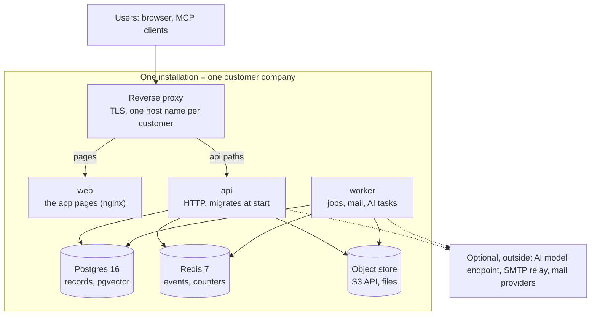

# Host Margince for other companies

One installation serves one company. To host Margince for several customers, run one installation for
each customer, for example in its own Kubernetes namespace. An installation has three services from one
release (api, worker and web) and three data stores (Postgres, Redis and an object store).

The proxy sends the api paths to the api, and the app pages to web. The api and worker
read and write all three data stores. They can also connect to the optional services outside.

## Choose a route

|  | Light | Standard | Your own platform |
| --- | --- | --- | --- |
| Suits | Proofs of concept and small pilots | Mid-sized production | Kubernetes, Nomad or a container runtime you already run |
| Application | Docker Compose on one Ubuntu 24.04 VM, Caddy for HTTPS in front of nginx | Managed containers: api, worker, web | The three images, one namespace per customer |
| Postgres and Redis | Containers on the VM, data on its own disk, daily snapshots | Managed Postgres 16; Redis 7.2 (a container on Azure, ElastiCache Valkey 7.2 on AWS) | Managed or self-run Postgres 16 with pgvector, and Redis 7.2 |
| Template | Terraform for Azure and AWS; on other clouds, the `host` adapter reuses the Compose setup | Terraform for Azure and AWS | None. Follow the steps on this page |

The templates are in the [template repository](https://github.com/margince/template/tree/main/deploy/production).
They create the infrastructure. You still run Margince: upgrades, backups and monitoring.

## What you need

| What | Notes |
| --- | --- |
| Postgres 16 with pgvector 0.5.0 or newer | A superuser installs the extension once. Allow 40 connections for one api and one worker |
| Redis 7.0 to 7.2 | Valkey works, but no test covers it |
| An S3-compatible object store | Holds attachments, images, offer PDFs and CSV imports |
| One host name per customer, with TLS | A reverse proxy ends TLS. The api and the web app use the same host name |
| A correct system clock | Retention and job schedules depend on it |
| A license token | One for each installation. See [License](#license) |
| Optional: an SMTP relay | For invitations, password resets and privacy notices |
| Optional: a model endpoint | For AI features: a cloud API key, or your own OpenAI-compatible endpoint (vLLM, Ollama or a gateway) |

The api, worker and web containers keep no state. All state is in Postgres, Redis and the object store.
Size each installation from [the single-node table](../reference/system-requirements.md#single-node).

## Install for a new customer

The full steps are in [deploy-margince.md](deploy-margince.md).

1. **Get the three images of one release**: api, worker and web. The worker refuses to start on a
   different release.
2. **Create the database** with [`db-bootstrap.sql`](../../scripts/deploy/db-bootstrap.sql), as a
   Postgres superuser. It creates `margince_owner` for migrations and `margince_app` for the services.
   Neither role may be a superuser.
3. **Set the environment** for the two database connections, Redis, the public URL, the key vault
   root key (`MARGINCE_KEYVAULT_ROOT_KEY`), the admin password and the license token. Start from [`.env.example`](../../.env.example).
4. **Write `margince.yaml`** from [the example](../../config/margince.example.yaml). Give the customer's
   company, the first admin and the country (`de` for Germany). Margince reads this file at every start.
   The `workspace`, `bootstrap_admin` and `seeds` blocks apply only on the first start.
5. **Route the customer's host name** as
   [Route one host to two services](deploy-margince.md#route-one-host-to-two-services) says.
6. **Set health checks** as [Point the health checks](deploy-margince.md#point-the-health-checks) says.
7. **Start the api first.** It applies the migrations. Then start the worker and web.
8. **Set up outbound mail** with [set-up-outbound-mail.md](set-up-outbound-mail.md).
9. **Hand over and clean up** as [After the first boot](deploy-margince.md#after-the-first-boot) says.

Never set `MARGINCE_ENV=dev` on a customer's installation. With it, Margince starts with no license,
accepts test licenses, and accepts a public URL that is not https.

## License

Each production installation needs its own license token from Gradion. Without one, the api and worker
refuse to start in production.

- **Where it goes:** in a secret file named in `margince.yaml`
  (`license.token: ${file:/run/secrets/margince-license}`), or in `MARGINCE_LICENSE`. Margince refuses a token
  written into the config file itself.
- **How it is checked:** offline, in the running process. The installation does not contact Gradion,
  so the check works with no outbound network.
- **Seats:** the token holds the seat count.
- **Reporting:** the installation sends no seat count or usage to Gradion.

The app has no screen to add a token. Set it before the first start.

## Upgrade

Deploy all three images of the new release. The api applies migrations at start, so there is no
separate migration step.

1. Make a backup (see [Back up](#back-up)).
2. Deploy the new api image, and wait until `/readyz` returns 200.
3. Deploy the worker and web images of the same release.
4. Finish the rollout before you leave it. Do not keep api replicas of two releases running together;
   workers refuse to start on mixed releases.

On one node, all services restart together, so an upgrade causes a short outage. Agree on a
maintenance window with the customer. Settings the admin changes in the app stay. Margince does not apply the
`workspace`, `bootstrap_admin` or `seeds` blocks again.

## Back up

Margince has no backup tool. Back up the parts below, the data at least every hour, and keep the root
key apart from the data backups.

| Part | Back up | How often |
| --- | --- | --- |
| Postgres | Yes, with point-in-time recovery or a dump | At least every hour |
| Object store | Yes, a separate copy that matches the database backup's point in time | At least every hour |
| `MARGINCE_KEYVAULT_ROOT_KEY` | Yes, in a secret store apart from the data backups | When it changes |
| `margince.yaml`, connection strings, license token | Yes, in a secret store or config repository | When they change |
| Redis | No. It holds no records | |

- **Turn off versioning on the live object store.** Margince deletes files to carry out erasure
  requests, and versioning keeps them.
- **Never restore `erasure-suppression/`** from a backup. Keep the latest copy, and run
  `worker replay-erasures` before users get access again.
- **Test the restore.** Run a [restore drill](run-a-restore-drill.md) on a schedule, for example each
  quarter.

## Who does what

| Task | You, the host | The customer | Gradion |
| --- | --- | --- | --- |
| License | | Gets it from Gradion | Issues the token |
| Infrastructure, TLS, DNS | Yes | | |
| Install, upgrade, monitor | Yes | | Publishes releases and security fixes |
| Backups and restore drills | Yes, unless agreed otherwise in writing | Agrees on how long backups are kept | |
| Users, roles and settings in the app | | Yes, through its admin | |
| AI model access | Gives the endpoint, if your offer includes it | Or gives its own key | |
| A security hole in Margince | Reports it | Reports it | Fixes it and tells operators |

Report a security hole as [SECURITY.md](../../SECURITY.md) says, never in a public issue.
