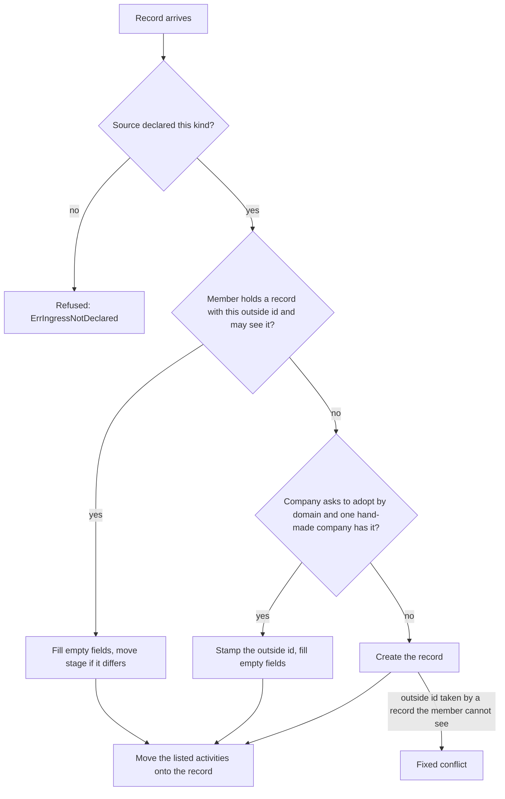

# Land companies and deals from an extension

An extension can hand the core a company or a deal it read from another system. The core matches the record by the id the other system gave it, then creates, updates or adopts. This page is for an extension author. It assumes you already capture activities as in [add-an-extension.md](add-an-extension.md#capture-records-from-your-own-provider).

## What you send

A `Record` carries one payload. Set `Company` or `Deal` instead of `Activity`. `Record.Kind()` reads which one it is.

| Field | Company | Deal |
|---|---|---|
| Outside id | `System` + `Key` on the record | `System` + `Key` on the record |
| Required | `DisplayName` | `Name`, `PipelineID`, `StageID` (core ids) |
| Optional values | `LegalName`, `Industry`, `Description`, `Domain` | `AmountMinor`, `Currency` |
| Natural key to adopt by | `AdoptOn: extension.AdoptKeyDomain`, which needs a non-empty `Domain` | none |
| Stage move | none | a different `StageID`; `LostReason` for a lost stage |
| Move activities onto it | `RelinkActivities` (activity keys, at most `extension.MaxRelinkActivities`, which is 50) | `RelinkActivities` (same cap) |

Declare the kinds in the source: `Lands: []extension.RecordKind{extension.KindActivity, extension.KindCompany, extension.KindDeal}`. A record whose kind the source did not list is refused at the call with `ErrIngressNotDeclared`.

A company or deal record takes no `Counterparty`, `Addresses`, `Participants` or `ThreadKey`. The core refuses a record that mixes payloads. The answer is a disposition of unrepresentable with the refusal class `activity`, the same class a broken activity gets.

## What the core does with it

- **The pair is unique across the workspace.** `(source_system, source_id)` is one record, whoever may see it. A clash with a record the member may not see answers the same fixed conflict (`ErrConflict`) as any other taken pair. It reveals only that the pair is taken, and never the record, its owner or its name.
- **Updates keep what a user typed.** The core fills a field only when it is empty. It does not rename a company or change a deal's value that already has one. A setting to overwrite is not built yet.
- **Adopt keeps the user's values too.** A hand-made company that lists the domain gets the outside id and fills only its empty fields. A company that already has an outside id from another system is a conflict, never taken over. If more than one company lists the domain, the record is a conflict and nothing is adopted. A company the member may not see does not count as a match.
- **Stage moves.** A move is the one change a unit may make. It runs through the deal's own move, so the exit criteria and the lost-reason rule apply. A lost stage without `LostReason` is refused as `ErrInvalid`. A win has no contract in Margince, so the core files it as an imported win.
- **Rights.** Every call is checked against the member's live rights. Create, adopt, update, move and relink each need the member's grant on that object. A member without it gets `ErrForbidden`, and nothing is written.
- **Relink keys.** A key that matches nothing the member may read is skipped. The list cannot be used to learn which activities exist. A list over 50 keys refuses the whole record, and an empty key does too.

A feed that runs as a [service member](declare-a-service-member.md) holds create, read and update on companies and deals through the `service_ingest` role. A new installation gets the deal grant when the first service member is declared. An installation that already has the role gets it from a migration. The migration adds the deal grant only where the role holds the company grant and has no deal grant yet. If an admin changed the role by hand, check that it still holds create, read and update on deals. Without that grant a deal record is refused with `ErrForbidden`.

## Run it twice

Landing the same record again finds the same row. Two calls that carry one outside id at the same moment leave one row and one create entry in the audit log. The loser of the race finds the winner and updates it.

The integration tests that prove this are in `backend/internal/compose/extingresscrm_integration_test.go`.
