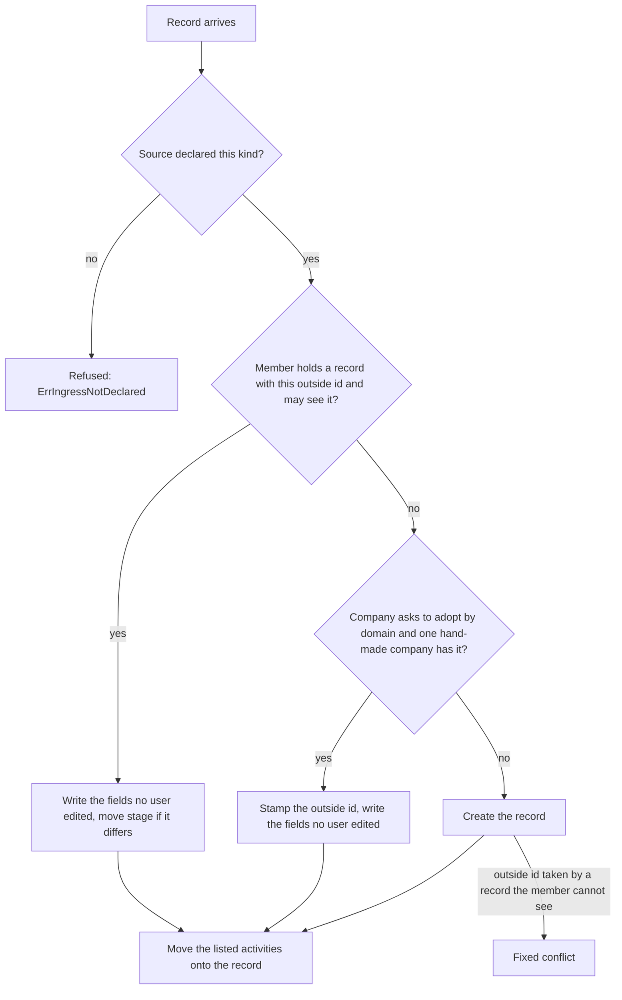
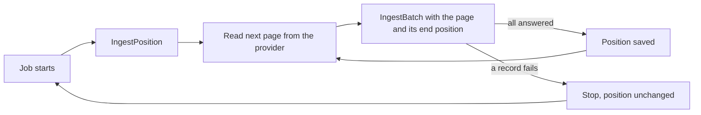

# Land companies and deals from an extension

An extension can hand the core a company or a deal it read from another system, or raise a signal about a record ([below](#land-a-signal)). The core matches the record by the id the other system gave it, then creates, updates or adopts. This page is for an extension author. It assumes you already capture activities as in [add-an-extension.md](add-an-extension.md#capture-records-from-your-own-provider).

## What you send

A `Record` carries one payload. Set `Company` or `Deal` instead of `Activity`. `Record.Kind()` reads which one it is.

| Field | Company | Deal |
|---|---|---|
| Outside id | `System` + `Key` on the record | `System` + `Key` on the record |
| Required | `DisplayName` | `Name`, `PipelineID`, `StageID` (core ids) |
| Optional values | `LegalName`, `Industry`, `Description`, `Domain` | `AmountMinor`, `Currency`, `CustomFields` (`cf_*` keys of active custom fields, at most `extension.MaxLandedCustomFields`, which is 50) |
| Natural key to adopt by | `AdoptOn: extension.AdoptKeyDomain`, which needs a non-empty `Domain` | none |
| Stage move | none | a different `StageID`; `LostReason` for a lost stage |
| Move activities onto it | `RelinkActivities` (activity keys, at most `extension.MaxRelinkActivities`, which is 50) | `RelinkActivities` (same cap) |

Declare the kinds in the source: `Lands: []extension.RecordKind{extension.KindActivity, extension.KindCompany, extension.KindDeal}`. A record whose kind the source did not list is refused at the call with `ErrIngressNotDeclared`.

A company or deal record takes no `Counterparty`, `Addresses`, `Participants` or `ThreadKey`. The core refuses a record that mixes payloads. The answer is a disposition of unrepresentable with the refusal class `activity`, the same class a broken activity gets.

## What the core does with it

- **The pair is unique across the workspace.** `(source_system, source_id)` is one record, whoever may see it. A clash with a record the member may not see answers the same fixed conflict (`ErrConflict`) as any other taken pair. It reveals only that the pair is taken, and never the record, its owner or its name.
- **Updates leave what a user edited.** The core writes the optional values you send, except a field a user last edited. It reads that from the audit trail, the same rule agents follow. The company fields it checks are `LegalName`, `Industry` and `Description`. The deal fields are `AmountMinor`, `Currency` and each key of `CustomFields`. It never checks the stage.
- **An amount and its currency go together.** If a user edited either one, even one you did not send, the core withholds both, so the user's amount is never re-priced in another currency.
- **The withheld fields come back.** `Result.Withheld` lists them by name, for example `industry`, or `amount_minor` and `currency` together. It is empty when nothing was withheld. The record is still accepted: this is not the `Skipped` disposition, which drops the whole record.
- **An admin can let a unit overwrite.** With the setting on, the core writes the field and `Withheld` stays empty. The core reads the setting on each call, before it checks the fields, so a change applies to the next record.
- **Adopt leaves the user's values too.** A hand-made company that lists the domain gets the outside id, and a field a user typed is left as it is. A company that already has an outside id from another system is a conflict, never taken over. If more than one company lists the domain, the record is a conflict and nothing is adopted. A company the member may not see does not count as a match.
- **Stage moves.** A move is the one change a unit may make. It runs through the deal's own move, so the exit criteria and the lost-reason rule apply. A lost stage without `LostReason` is refused as `ErrInvalid`. A win has no contract in Margince, so the core files it as an imported win.
- **Rights.** Every call is checked against the member's live rights. Create, adopt, update, move and relink each need the member's grant on that object. A member without it gets `ErrForbidden`, and nothing is written.
- **Relink keys.** A key that matches nothing the member may read is skipped. The list cannot be used to learn which activities exist. A list over 50 keys refuses the whole record, and an empty key does too.

A feed that runs as a [service member](declare-a-service-member.md) holds create, read and update on companies and deals through the `service_ingest` role. A new installation gets the deal grant when the first service member is declared. An installation that already has the role gets it from a migration. The migration adds the deal grant only where the role holds the company grant and has no deal grant yet. If an admin changed the role by hand, check that it still holds create, read and update on deals. Without that grant a deal record is refused with `ErrForbidden`.

## Let a unit overwrite edited fields

An admin decides this for each extension. The default is to leave edited fields as they are.

| What | Value |
|---|---|
| Where | Settings, Extensions, the unit's card, "Overwrite fields a user edited" |
| Read | `GET /v1/extensions/{name}/settings`, needs the `extension_access` read grant |
| Change | `PUT /v1/extensions/{name}/settings` with `{"overwrites_edited_fields": true}`; admin only, a signed-in user only. Always send `overwrites_edited_fields`: the call saves it every time, so a body without it turns the switch off. |
| Unknown unit name | 404 |
| Settings a unit declares | The same two calls carry them in `declared`, for an admin only. See [add-an-extension.md](add-an-extension.md#declare-settings-an-admin-can-change). The switch and the declared values save in one transaction, so a refused value saves nothing. |
| Stored as | one setting, `identity.extension_overwrites_edited_fields`, a map from unit name to true or false; a unit not in the map reads false |
| Audit | each change writes an `update` entry on `installation_settings` with the old and new map |

## See what a unit offered

The core keeps the last value each unit offered for a company's `legal_name`, `industry` and `description`. It keeps the value whether the record took it or kept a user's edit, so a screen can read both. The record page does not show the offered value yet.

| What | Value |
|---|---|
| Read | `GET /v1/companies/{id}/offered-values`, for a signed-in user. Needs read on companies and the right to see that company, else 403 or 404. An archived company answers 404. |
| Answer | One entry per source and field: `source_system`, `field`, `value`, `offered_at`. Empty when nothing was offered. |
| Replaced | A unit that offers a field again replaces its own earlier value. Another unit's value for the same field stays. |
| Not kept | A field the unit leaves empty. Deals are not covered. |
| Stored in | `company_offered_value`. The values may hold personal data. |
| Erased | Erasing or anonymizing a contact deletes the offered values of every company that contact was employed by, because the text can quote an employee. The next feed run offers the current values again. The table is not in the access report, which holds data about the subject and not about the company. |
| Removed | When the company row is deleted outright. Archiving keeps them for a restore and stops serving them. |
| Audit | Each write adds an `update` entry on the company that names the source and the fields, never the values. No event is sent. |

## Load a large source in batches

A job that loads a large source can hand records over a page at a time and let the core remember where it stopped. A restarted job asks for that position and carries on from it. Use it only when one run cannot finish the load; a small feed needs a plain `Ingest` per record.

| Call | What it does |
|---|---|
| `rt.IngestBatch(ctx, on, system, recs, position)` | Lands the records in order, as `Ingest` does for each, then saves `position` for that source. Returns one result per record. |
| `rt.IngestPosition(ctx, system)` | Returns the saved position, or an empty string when none was saved. |

| Rule | Value |
|---|---|
| Records per batch | At most `extension.MaxBatchRecords`, which is 200. All must carry the batch's `system`. |
| Position | 1 to `extension.MaxPositionBytes` (512) bytes of text. It is your own cursor: a page token, a last-seen id. The core never reads it. |
| Who may call `IngestBatch` | An unattended run, such as a job tick, for a source the unit declared. Any other call gets `ErrAttendedIngest` or `ErrIngressNotDeclared`. |
| Who may call `IngestPosition` | Any invocation of the unit, for a source the unit declared, else `ErrIngressNotDeclared`. It checks nothing else, because it reads one saved text and writes nothing. |
| When it is saved | After every record is answered. |
| What ends a batch | An error from a record: a kind the source did not declare, a member who has no credential with the unit or lost the right to land the record, a call from inside a transaction, or a store failure. You get the results so far and the error, and the saved position does not move. A skipped record and an unrepresentable record are results, not errors, so they do not end the batch. |
| A record that always fails | It ends every batch that holds it, so the saved position never passes it. Fix the cause, or leave the record out of the batch. |
| Stored in | `extension_ingest_position`, one row per unit and source. |

After a stop, the next run reads the old position and offers the half-done page again. Records that already landed are matched by their outside id, so the second offer changes nothing. The integration tests are in `backend/internal/compose/extingressbatch_integration_test.go`.

## Land a signal

An unattended run can also raise a signal about a record, with the evidence layout the unit declared in [Declare a signal type](add-an-extension.md#declare-a-signal-type). Set `Signal` instead of `Activity`, and list `extension.KindSignal` in `Lands`.

| Field | Meaning |
|---|---|
| `Key` | Your own key for the event, the same on every re-read. Core builds the fingerprint from the signal kind, the subject and this key, so two units cannot collide. |
| `Signal.Kind` | The short name of a signal type you declared. Core spells the stored kind `ext:<unit>:<kind>`. |
| `Signal.Subject` | The record's `Type` and `ID`. The type must be a record kind the source lists in `Lands`, and the member must be able to see the record. |
| `Signal.Evidence` | A summary and the layout members. They are checked against the declared layout. |

| Rule | What happens |
|---|---|
| Authority | The signal is written as the member in `on`, with their live rights. It needs their grant to create signals. A member demoted since the last call is refused with `ErrForbidden`. |
| Subject | A record the member cannot see answers `ErrNotFound`. A subject type the source did not list answers `ErrIngressNotDeclared`. |
| Repeat | The same kind, subject and key answers `DispositionAlreadyRaised` with the held signal's `Ref`. That is a success, so move your cursor on. A signal a person dismissed stays dismissed, and a replay does not raise it again. |
| New signal | `DispositionAccepted`. Core writes the signal, its audit row and its `signal.detected` event in one transaction. |
| Edits | A unit cannot change a signal's kind or evidence afterwards. |
| Personal data | A layout member marked `Personal` is removed when the contact it is about is erased. |

An attended call is refused with `ErrAttendedIngest`, as for every kind. The integration tests are in `backend/internal/compose/extingresssignal_integration_test.go`.

## Run it twice

Landing the same record again finds the same row. Two calls that carry one outside id at the same moment leave one row and one create entry in the audit log. The loser of the race finds the winner and updates it.

The integration tests that prove this are in `backend/internal/compose/extingresscrm_integration_test.go`.
