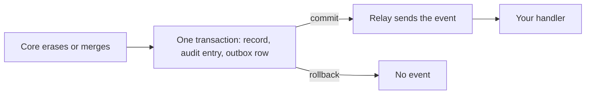

<!-- prose:plain -->
# React to company and deal lifecycle events

Three events tell an extension that a company or a deal ended: `company.erased`, `deal.erased` and `deal.merged`. This page is for an extension author who keeps its own copy of a core id and needs to drop or update it. The events are declared and ready to subscribe to. Core does not publish them yet, because it has no company erase, deal erase or deal merge operation. They start when those operations land.

## The events

| Event | When | What it carries |
|---|---|---|
| `company.erased` | A company is erased for good, not archived. | Nothing. The event names the erased company's id. |
| `deal.erased` | A deal is erased for good, not archived. | Nothing. The event names the erased deal's id. |
| `deal.merged` | Two deals become one. | `merged_from_id`, the deal that was removed, and `merged_into_id`, the deal that stays. |

`company.merged` already works the same way as `deal.merged`. The full payload tables are in [webhook-events.md](../reference/webhook-events.md).

## What an event never carries

An event holds ids only. An erase event has no name, no price and no other field of the record, so it cannot hand back what the erasure removed. Read the kept record by `merged_into_id` if you need its data.

The shape a read of an erased id will answer is declared as `Tombstone` in `backend/pkg/extension/coreread.go`. It has two fields, `id` and `kind`, and no others. No read returns it yet, because core has no erase operation. Until then, a read of an erased id answers `ErrNotFound`, as a missing id does.

## When the event is sent

A store writes the event in the same transaction as the change, through the outbox. The bus sends it only after that transaction commits. A change that rolls back sends nothing.

## Won, lost and relink

These need no new event. A won or lost deal is already a `deal.stage_changed`. Moving an activity to another record is already an `activity.updated`.

## Check your handler

The bus can send an event twice, so key your handler on the delivery's `EventID`. To see the payload shapes, run `cd backend && go test ./internal/modules/deals -run TestEraseAndMergeEvents`.
