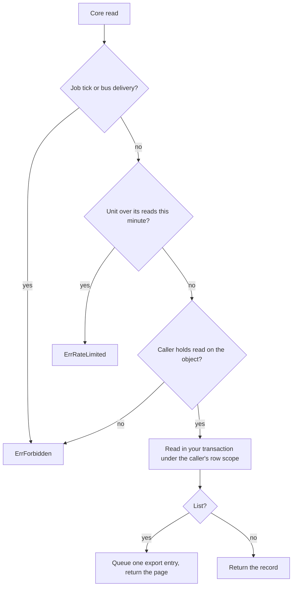

# Read core records from an extension

An extension can read deals, companies, signals, activities and the custom-field list through `tx.Core()`. Each read answers what the user who made the call may see, never more. This page is for an extension author. It assumes you already hold a transaction as in [add-an-extension.md](add-an-extension.md).

## The verbs

| Door | Verbs | Filters on `List` |
|---|---|---|
| `tx.Core().Deals()` | `Get`, `List` | `Search`, `StageID`, `OwnerID`, `CompanyID`, `Status`, `SourceSystem` + `SourceID`, `CustomFields`, `IncludeArchived` |
| `tx.Core().Companies()` | `Get`, `List` | `Search`, `OwnerID`, `Domain`, `Lifecycle`, `SourceSystem` + `SourceID`, `CustomFields`, `IncludeArchived` |
| `tx.Core().Signals()` | `Get`, `List` | `Kind`, `Status`, `ResolutionState`, `CompanyID`, `IncludeArchived` |
| `tx.Core().Activities()` | `Get`, `List` (and `Create`) | `Kind`, `Search`, `EntityType` + `EntityID`, `CustomFields`, `IncludeArchived` |
| `tx.Core().CustomFields()` | `List(ctx, object)` for `deal`, `company` or `activity` | none |

The query types and the page type are in `backend/pkg/extension/coreread.go`. The record shapes come from `backend/pkg/extension/crm`, the same ones the REST API documents. A date is the text `2026-01-31`.

A custom-field value comes back on the record in `AdditionalProperties`, keyed by column name such as `cf_region`. To filter on one, put the same name in `CustomFields`. A name that is not an active field answers `ErrInvalid`. `CustomFields().List` tells you which names exist.

Signal and activity filters cover the columns above. A filter on the details inside a signal's evidence is not built, because that data has no structured, indexed form yet.

## What the core does with a read

| Rule | What you see |
|---|---|
| No caller, no read | A job tick or a bus delivery has nobody to check against, so every verb answers `ErrForbidden`. A tick reads through `Extension.SystemReads` instead. |
| The caller's rights | The same object grant, row scope and field masks as the product's own list. A caller without the grant gets `ErrForbidden`. |
| A record the caller cannot see | `Get` answers `ErrNotFound`, the same as a missing id. A `List` leaves it out. Deals and companies are shared across the workspace by the product's own rule, so what stays hidden is what the product hides: a company a colleague's mailbox captured and nobody has promoted, and the signals and activities the product's own scope hides from that caller. |
| One page at a time | `Limit` is 50 when you leave it at zero, and is cut to `extension.MaxReadPage`, which is 100. A negative `Limit` answers `ErrInvalid`. Continue with `NextCursor`. |
| A rate per unit | A unit may make 600 core reads a minute across all its calls. The next one answers `ErrRateLimited`, and the same call works in the next minute. |
| Your transaction | A read runs on the transaction you hold, including the custom-field list. It never takes a second connection. |

## A list is audited as an export

Each `List` writes one `export` entry to the system log. It names the unit, the table, the number of rows returned and the names of the filters used. It never records filter values, because a search term can be personal data. The acting user is the caller. A `Get` writes nothing.

The core writes the entry after your transaction ends, in a transaction of its own. If your transaction rolls back, the entry stays, because you have already read the records. If the core cannot write it, the call answers that error.

## Check your own reads

The integration tests in `backend/internal/compose/extcoreread_integration_test.go` run each verb on a pool with one connection, so a read that reaches for a second connection hangs and fails. The unit tests in `backend/internal/compose/extcoreread_test.go` cover the tick refusal, the rate cap and the page cap. Run one with `make test-it DIR=backend/internal/compose RUN=<Test>`.
