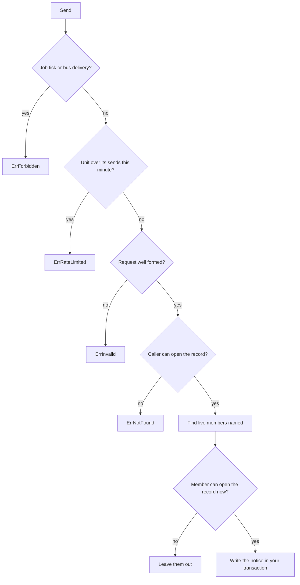

# Send a notice from an extension

An extension can tell a member, or everyone in a role, about a core record with `tx.Core().Notices().Send`. This page is for an extension author. It assumes you already hold a transaction as in [add-an-extension.md](add-an-extension.md).

## What you pass and what you get

| You pass | Meaning |
|---|---|
| `Member` | A user id. Name this or `Role`, never both. |
| `Role` | A role key. The notice goes to every live member who holds it. |
| `Record` | The record the notice is about: `Type` is `contact`, `company` or `deal`, and `ID` is its id. |
| `Subject` | One short line in your own words. The core cuts it at 200 characters. |
| `Key` | Optional. A name for the event. A second send with the same key to the same member writes nothing. |

`Send` answers `NoticeSent.Recipients`, the number of members it newly told. A member a retry under the same `Key` had already told is not counted, so a full retry answers zero. Zero is a normal answer.

You never pass an address or a channel. The core picks how each member is reached from their own notification settings. The notice has no body: it points at the record, so what a reader sees of the record is decided when they open it, and no personal data is copied into the notice. The types are in `backend/pkg/extension/notices.go`.

## What the core does with a send

| Rule | What you see |
|---|---|
| No caller, no notice | A job tick and a bus delivery have nobody to check against, so `Send` answers `ErrForbidden`. A notice started by a scheduled job is refused for now. |
| The caller must see the record | A record the caller cannot open answers `ErrNotFound`, the same as a missing id. |
| Recipients are resolved at send time | Only members who are active and not archived or erased are reached. Each must hold read on the record type and pass their own row scope. Someone who fails either is left out without an error. |
| A rate per unit | A unit may call `Send` 60 times a minute across all its calls. The next call answers `ErrRateLimited`. The count is per call, not per member reached. If the shared counter is down, the call is refused. |
| Your transaction | The notice, its audit row and its event commit with your own rows, or not at all. |

## The notice class

An extension notice has the kind `extension_notice` and sits in the `system` class. That class is delivered in the app by default, and a member can switch it off in their notification settings. A class of its own would need a row on every settings screen, so it is not added yet.

## Check your own sends

The unit tests in `backend/internal/compose/extnotice_test.go` cover the tick refusal, the request checks and the rate cap. The integration tests in `backend/internal/compose/extnotice_integration_test.go` cover role resolution, who is left out and the retry key. Run one with `make test-it DIR=./internal/compose RUN=<Test>`.
