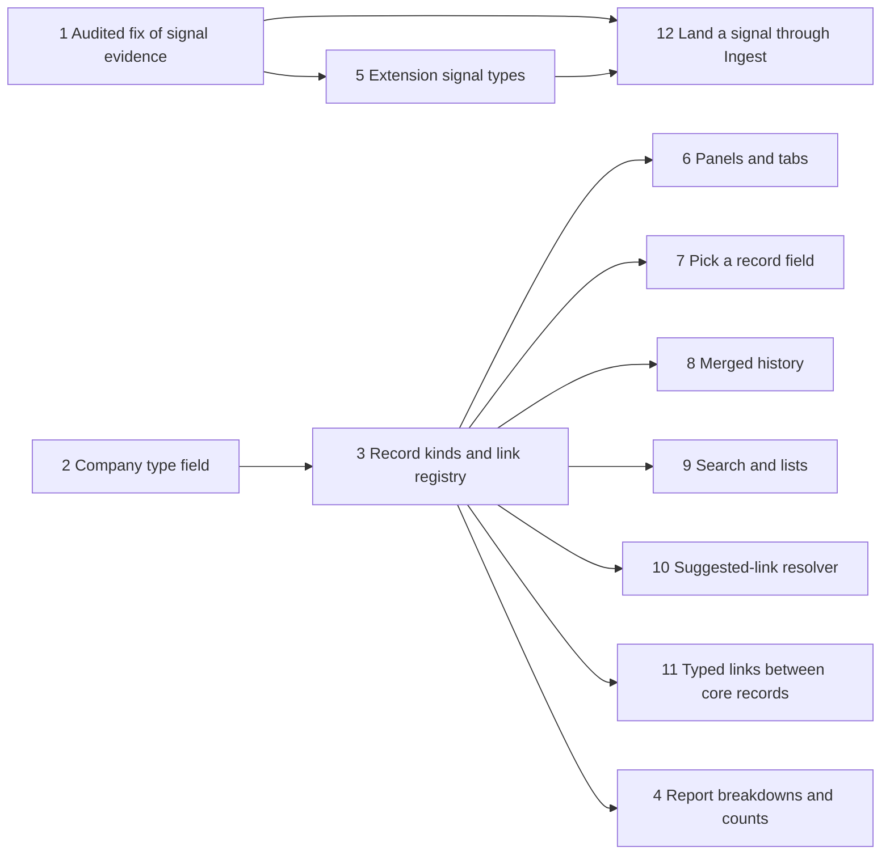
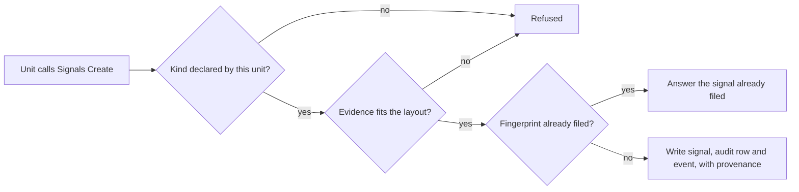
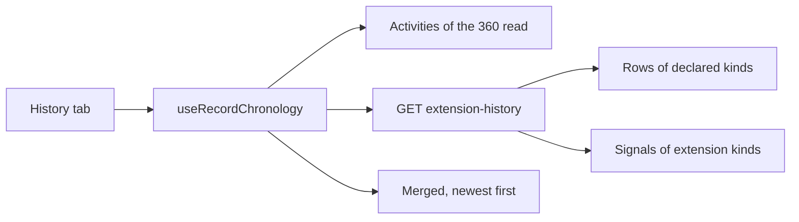
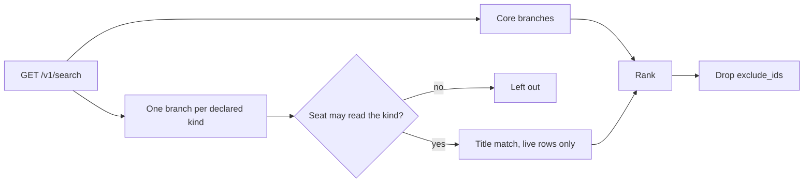
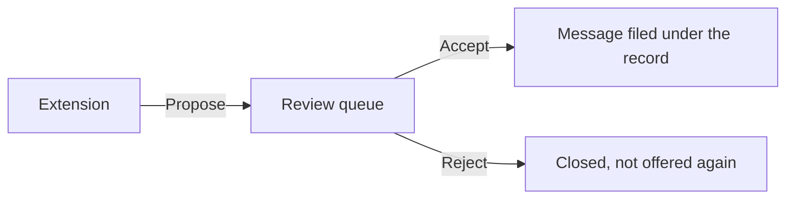

# An extension cannot add its own record kinds, links, signals or reports

This package of work lets an extension bring its own record kinds, links between records, signals and reports into
Margince. It is for those who build or run extensions. Each feature ships on its own, and the table says which ones
are done.

## How to read this page

| Column | Meaning |
|---|---|
| **Feature** | One piece of the package, in build order. |
| **What someone can do now** | What works today. A planned feature says nothing yet. |
| **Page with the details** | Where the facts are. |
| **State** | **done** is built and merged. **planned** has not started. |

| # | Feature | What someone can do now | Page with the details | State |
|---|---|---|---|---|
| 1 | Audited fix of signal evidence | Correct a signal's type and evidence. The old values stay in the audit log. | [Audited fix of signal evidence](#audited-fix-of-signal-evidence) | done |
| 2 | Company type field | Declare a company type in an extension and set it on a company. See it in the company list and filter by it. | [Company type field](#company-type-field) | done |
| 3 | Extension record kinds and link registry | Declare a record kind in an extension. Tag it, put it on a Shortlist and refuse access to it by default. Read the kinds you may see from `GET /v1/record-kinds`. | [Extension record kinds and link registry](#extension-record-kinds-and-link-registry) | done |
| 4 | Extension report breakdowns and counts | Declare a count or a breakdown in an extension. See it on Reports and Home, under the seat's row scope, field masks and the group floor. A multi-select custom field can be split by. | [Extension report breakdowns and counts](#extension-report-breakdowns-and-counts) | done |
| 5 | Extension signal types with structured evidence | Declare a signal type in an extension, with an evidence layout that marks personal data. File a signal of it. The same event reported twice leaves one signal. Erasing a contact removes the personal members. | [Extension signal types with structured evidence](#extension-signal-types-with-structured-evidence) | done |
| 6 | Panels and tabs on record pages | Draw a component of the unit's own on a contact, company or deal page, with the record the page shows. A reader needs `read` on the panel's object. | [Panels and tabs on record pages](#panels-and-tabs-on-record-pages) | done |
| 7 | "Pick a record" field type | Add a custom field of type `record` that points at one record of a kind an extension declared. Set and read it on the record pages and in the settings table. | ["Pick a record" field type](#pick-a-record-field-type) | done |
| 8 | Record page with merged history for extension kinds | Declare a timeline for a record kind. Its rows that reference a contact, company or deal, and the unit's signals about it, show in that record's History beside activities and field changes. | [Record page with merged history for extension kinds](#record-page-with-merged-history-for-extension-kinds) | done |
| 9 | Search and lists for extension kinds | Find a kind's rows in search. List them in a Shortlist or a Live List, filter them in the Filters screen and keep a saved view over them. | [Search and lists for extension kinds](#search-and-lists-for-extension-kinds) | done |
| 10 | Suggested-link resolver | Propose which deal, company, contact or project a message belongs to. A reader accepts or rejects each suggestion in a queue on the Worklist. Nothing is filed until they accept. | [Suggested-link resolver](#suggested-link-resolver) | done |
| 11 | Typed links between core records | Link a deal, company or contact to another with a type from core or from an extension. See the links on the deal page, filter the deal list by link type and group deals by it in Reports. | [Typed links between core records](#typed-links-between-core-records) | done |
| 12 | Let an unattended extension run land a signal through Ingest | Nothing yet. | None yet | planned |

## Audited fix of signal evidence

A signal can be corrected after it is filed. `PATCH /v1/signals/{id}` now accepts `kind` and `evidence` next to
`status`, `note` and `severity`. The request is `UpdateSignalRequest` in `backend/api/crm.yaml`.

| Field | What it does |
|---|---|
| `kind` | Changes the signal's type. Only the six kinds filed by hand are accepted: `stalled_deal`, `champion_left`, `reengagement`, `buying_intent`, `risk` and `other`. |
| `evidence` | Replaces the whole evidence list. |

The edit uses the existing `update` audit action, so no new action exists. The audit row's before image holds the old
kind and evidence, and its after image holds the new ones. An edit that changes nothing writes no audit row.

The old values live only in that audit row. The audit log view shows them to a user who may read it.
An erasure of a contact writes an erase row against each signal about that contact. The history views then hold back
every image written before that row, so the old kind and evidence are no longer served.
The data-access export for a contact does not list signals, so these old values are not in it yet.

The request contract accepts only those six kinds. The store also accepts the signal's current `kind` unchanged, even
when it is outside the six, so a client can send back what it read. Any other change of `kind` is refused with a 422 on
the field `kind`, code `invalid_kind`, and nothing changes. The maintainers decide which of the other signal kinds may be
corrected. Until then they are refused.

## Company type field

An extension can add company types beside core's fixed list. The steps to declare and set one are in
[Declare a company type](../how-to/add-an-extension.md#declare-a-company-type).

The extension's types live in their own field, `extension_relationship_types`, and core's `relationship_types` list
is unchanged. A published list that grows cannot be narrowed again, and a client that switches on the old list would
meet a value it never saw. The list filter follows the same split. The two fields share one table, so one company can
carry both.

| Part | What it does |
|---|---|
| Value | `ext:<unit>:<type>`, built from the declaring unit's name. A unit cannot set another unit's value. |
| `Extension.CompanyTypes` | The unit declares the types and a label for each. The boot refuses a bad name or a duplicate. |
| `SetExtensionTypes` | The unit sets its own types on a company. It leaves other units' types alone. |
| `PATCH /v1/companies/{id}` | A user or an agent sets `extension_relationship_types`. A value no unit declares is a 422 with the code `invalid_enum`. |
| `GET /v1/company-types` | Lists every declared value and its label, for any signed-in user. |
| `extension_relationship_type` list filter | Takes a declared extension value. The `relationship_type` filter stays core's closed list, because narrowing a published parameter later breaks clients. |
| Agent tools | The company update shape carries `extension_relationship_types`, the same as the REST body. |

`partner` works as before: it needs a partner row, and removing it while a partner row exists is a 422. Setting an
extension type does not touch it. The database check on `company_relationship_type` accepts the shape
`ext:<unit>:<type>`; which pairs exist is decided by the composed set, not by the database.

## Extension record kinds and link registry

An extension can declare a kind of record of its own, such as a visit or a ledger account. Core then treats the kind as
a record in tags, Shortlists, the audit log and the places that name a kind, under rights that start denied. The steps to
declare one are in [Declare a record kind](../how-to/add-an-extension.md#declare-a-record-kind).

A kind is named `ext:<unit>:<kind>`. The unit is the extension's name. The kind is a lower-case letter followed by up to
31 lower-case letters, digits or underscores. The spelling is permanent once a row carries it, because every column
that names a kind accepts it as a pattern.

| Part | What it does |
|---|---|
| `Extension.RecordKinds` | The unit declares each kind: a display name, its own table, fields, a natural key, optional starting grants and a delete policy. The boot and `make gen` refuse a bad declaration. |
| Registry | The core keeps the declared kinds in memory, filled at boot. Tags, lists and the rights check ask it, so none of them imports a unit. |
| Rights | Each kind is gated on its own RBAC object, `ext_<unit>_<kind>` with hyphens turned into underscores. A role holds nothing on it until the unit's starting grants or an admin give it. |
| Row check | A link, a tag or a Shortlist member needs the kind's `read` right and a live row in the unit's table. A caller without the right gets not found, so the id is not disclosed. |
| Natural key | The unit's table keeps a unique index over the declared fields and no others. The readiness probe fails while a declared table, a column or that index is missing. |
| Delete policy | `archive_only` (the default) keeps the row. `erasable` lets the row be erased through the erasure path. |
| `GET /v1/record-kinds` | Lists the kinds the signed-in seat may read, with fields, natural key, delete policy and the actions the seat holds. |
| Audit | A change to an extension record is written with the `ext:<unit>:<kind>` name as its entity type and the existing actions. No new action is needed. |
| Frontend | `isExtensionEntityKind` reads the spelling and `useRecordKindDirectory` loads the declared kinds. An extension kind has no record page, so `recordRoute` names none. |

The database accepts the spelling in every column that named a kind. The columns are listed in the table below. A gate
fails a new column that restates a closed list.

| Table | Column |
|---|---|
| `activity_link` | `entity_type` (with `ext_entity_id` for the record's id) |
| `attachment`, `embedding`, `list`, `list_member`, `list_live_member`, `list_member_event`, `taggable`, `user_record_view`, `signal` | `entity_type` |
| `field_provenance` | `object_type` |
| `record_grant` | `record_type` |
| `dedupe_candidate` | `entity_type` (with `left_ext_id` and `right_ext_id`) |
| `saved_view` | `resource` |

No column gains a foreign key to an extension table, because an extension role cannot be referenced from core.

What this feature does not do yet:

- The activity writers still refuse an extension kind, so no activity is filed on an extension record yet. The column is ready.
- The record page keeps core's kinds. Tag counts do not include extension records.

## Extension report breakdowns and counts

An extension can add named counts and breakdowns to Reports and Home. A count is how many live records a population
holds. A breakdown splits that count by one field. The steps to declare one are in
[Declare a report count or breakdown](../how-to/add-an-extension.md#declare-a-report-count-or-breakdown).

A declaration is data, never SQL. Core builds the query and runs it through the same report engine as its own reports,
so a unit cannot register a report that skips a gate. Every name is `ext:<unit>:<name>`, built from the declaring unit's
name.

| Part | What it does |
|---|---|
| `Extension.ReportCounts` and `Extension.ReportBreakdowns` | The unit declares a name, a label and a population. A breakdown also names the field it splits by. The boot and `make gen` refuse a bad name, a duplicate, or a population that is neither one of the unit's own kinds nor a core report population. |
| Population | The short name of a record kind the unit declares, or the key of a core report population. A core key has a hyphen and a kind name never does, so the two cannot be confused. |
| Field of a unit's kind | One of the fields the kind declares. |
| Field of a core population | A custom field of the deal, written `cf_<name>`, or of its company, written `company_cf_<name>`. Only the deal populations take one. |
| Multi-select fields | Core's own rule keeps a multi-select field out of reports, because a record would fall in several groups and the groups would not add up. A registered breakdown admits one and splits by the sorted combination of values a record holds. One record is in one group and the groups add up to the whole. |
| Row scope | A unit's kind has no owner, so the kind's `read` right is its whole scope: a seat without it gets nothing and the report is left out. A core population keeps its own row scope. |
| Field masks | A mask that reaches the kind or the population takes the rows out of every group. The answer carries how many in `excluded_by_permission`. |
| Group floor | A group below the analytics group floor is withheld. The floor is the one the analytics questions use, five by default. The smallest remaining group goes with it, and so does the total. A count under the floor is withheld too. |
| `GET /v1/extension-reports` | Answers every report the seat may read. A report whose custom field this installation does not define is left out. |
| Reports and Home | The Reports Pipeline page and the Home side column draw each answer in a panel. Both read the same endpoint. |

The frontend holds no list of registered names. The label and the groups come from the answer, so the screens cannot
drift from the registry. The contract's `kind` values `count` and `breakdown` are held equal to the registry's by a
unit test.

What this feature does not do yet:

- A breakdown by a field of a signal's evidence is not offered. Evidence members are named now, but no report reads
  them yet.
- A report is not an entity of the analytics question builder, and has no drill-through.
- A core population other than the deal's takes counts only.

## Extension signal types with structured evidence

An extension can add its own kinds of signal, each with an evidence layout declared as data. The steps to declare one
are in [Declare a signal type](../how-to/add-an-extension.md#declare-a-signal-type).

The maintainers chose one database kind per extension type, spelled `ext:<unit>:<kind>`, over one generic `ext` kind
with the type inside the evidence. Every filter, count and screen already switches on `kind`, and the spelling matches
record kinds and company types. The spelling is permanent once a row carries it.

| Part | What it does |
|---|---|
| `Extension.SignalTypes` | The unit declares each kind: a name, a label and the evidence members. The boot and `make gen` refuse a bad name, a duplicate member or an unknown type. |
| Evidence layout | Each member has a name, a label, a type (`text`, `number` or `bool`), `Required` and `Personal`. A member the layout does not name, a missing required one or a wrong type is refused with `invalid_evidence`. |
| `Signals().Create` | Files one signal about a deal, company, contact or project, under the caller's own rights. It writes the signal, its audit row and its `signal.detected` event in the unit's transaction. A scheduled job or a bus delivery is refused. |
| Fingerprint | Required. The stored fingerprint is the kind plus the unit's value, so two kinds or two units cannot swallow each other's signals. The existing unique index on live fingerprints holds the repeat out, and the call answers the first signal with `created` false. The answer is a read, so a signal the caller cannot see is not found. |
| Provenance | Core writes the `provenance` member of the evidence claim with the unit and the signed-in seat. A unit cannot set it. The `fields` and `provenance` members of a claim are also refused on a request to create or edit a signal. |
| Only the unit files it | `POST /v1/signals` refuses an `ext:` kind with the field `kind`, because only the declaring unit's call checks the layout, the owner and the fingerprint. |
| Evidence is fixed | The evidence of an extension signal cannot be replaced by `PATCH /v1/signals/{id}`, because a replacement would drop the layout members and the provenance. |
| `signal_kind_check` | Keeps core's sixteen kinds as a closed list and also admits the `ext:<unit>:<kind>` spelling. Which names exist is decided by the composed set at boot. |
| Contract | `kind` on a signal is a string that matches core's kinds or the extension spelling. A client must treat a kind it does not know as a kind of its own. The list filter `kind` keeps core's sixteen values. |
| Screens | A kind with no catalog text shows its own name, without the `ext:<unit>:` prefix. |

### Erase

Erasing or anonymizing a contact rewrites the extension signals whose subject is the contact, and those the resolver
attributed to them. The summary and each claim's snippet are
free text a unit wrote, so both become `[erased]`. A layout member marked `Personal` is removed. A signal whose kind no
unit declares loses all its members, because nothing says what is safe to keep. The provenance stays, because it names a
unit and a seat and never the subject. Signals of core's own kinds are not rewritten by this path.

What this feature does not do yet:

- A report does not read evidence members. See [the reports section](#extension-report-breakdowns-and-counts).
- Signals about a contact are not in the data-access export, as noted for the audited fix of evidence.
- The list filter on `kind` does not take an extension kind.
- Erase reaches the signals whose subject is the contact, and those the resolver attributed to the contact. A `Personal`
  member on a signal about a company or deal that is not attributed to the contact is not reached, because nothing links
  it to one.
- An extension signal cannot be moved to another kind by an edit.
- Subjects stay deal, company, contact and project.

## Panels and tabs on record pages

An extension can draw its own component on a contact, company or deal page. The steps to declare one are in
[Draw a panel on a core page](../how-to/add-an-extension.md#draw-a-panel-on-a-core-page).

The maintainers chose one panel slot per record kind over a single tab slot. The panel mechanism already fences each
unit's failure in its own card, gates it on the unit's RBAC object and hands it the record. A tab slot would need a
second mechanism for the same result. The unit's own screen stays reachable from the page header through
`record_header.<kind>` entries, which carry `record_type` and `record_id`.

| Slot | Where the panel shows |
|---|---|
| `record_panel.contact` | The end of a contact page's **Data & tools** tab, after its lists |
| `record_panel.company` | The end of a company page's **Contacts** tab, after the reach card |
| `record_panel.deal` | The end of a deal page's **Edit details** drawer, after its lists |

The Go list is `extension.PanelSlots()` in `backend/pkg/extension/panel.go`. The frontend list mirrors it, and
`backend/gates/frontendentryslots_test.go` fails when the two differ or when a slot is not mounted on a page. A panel
imports only published `@margince/frontend` subpaths, so the `ext-imports` gate holds it to the same surface as the rest
of the unit. The header entries and the Log activity entry are unchanged.

## "Pick a record" field type

An admin can add a custom field that points at one record of a kind an extension declared, such as a visit. The field
type is `record`. It joins the closed list of custom field types before the published contract is frozen, because a
published list that grows later breaks clients that switch on the old one. The general rules for custom fields are in
[What a custom field may be](../explanation/custom-fields.md#what-a-custom-field-may-be-the-closed-sets).

| Part | What it does |
|---|---|
| Type | `record` is added to the `custom_field_type_check` constraint, to `FieldTypes` in `engine.go`, to `fieldcatalog.Types()` and to the mirrored list in `frontend/src/lib/customfields.logic.ts`. The `type` enums of `CustomField` and `CreateCustomFieldRequest` in `backend/api/crm.yaml` gain the value. |
| Kind | The field's single `options` entry names the kind. The create is refused with `invalid_record_kind` on `options` unless it is one kind some unit declared and nothing else. |
| Storage | One nullable `text` column that holds the record id. A write whose value is not a UUID is a 422 `invalid_value`. |
| Filters and import | The field is filtered and sorted as text, and a CSV import reads the id as text. |
| Admin screen | The builder offers the type only when an installed extension declares a kind, and asks which kind. The settings table names the type, and a type the build does not know shows its own name with a plain icon. |
| Record screens | The create and edit forms and the record pages show the field as a text control that holds the id. |

An extension that reads the field through `pkg/extension` sees `Type` `record` and the kind in `Options`.

What this feature does not do yet:

- The value is not checked against the extension's table, so an id that names no row is stored. The check needs a
  row lookup through the registry, and no page of its own or search exists for the kinds yet. See feature 9.
- The control takes the id as text. A picker that lists the kind's records waits for search over extension kinds.

## Record page with merged history for extension kinds

A unit can put its own rows and signals into the History tab of a contact, company or deal. The steps to declare it are
in [Show a kind's rows in a record's History](../how-to/add-an-extension.md#show-a-kinds-rows-in-a-records-history).

The maintainers chose to read the unit's own tables over writing an activity for each row. The activity writers and
`ActivityLink` stay closed to core's kinds, so no activity is filed on an extension record. A row shows because it
references the core record, and its unit declares which columns say how.

| Part | What it does |
|---|---|
| `RecordKindDeclaration.Timeline` | Names the label field, the time column and, per core record, the `uuid` column that references it. The boot and `make gen` refuse a label that is no declared field, a bad column name, no subject or a repeated one. |
| `GET /v1/extension-history` | Takes `entity_type` (`contact`, `company` or `deal`) and `entity_id`. It answers `record` and `signal` entries, newest first. |
| Row scope | The core record is probed first, so a record outside the seat's scope is a 404. A kind the seat may not read is left out. Signals go through the signals module's own visible reader, so its row scope applies. |
| Limits | At most 50 rows per kind and 50 signals. An archived row and a row with no time are left out. |
| Signals | Only signals of an extension kind (`ext:<unit>:<kind>`) whose subject is the record. Signals of core's kinds stay in the signal strip. |
| `useRecordChronology` | Reads the answer for a contact, company or deal under every cut that reads the exchanges, and merges it with the activities. The activities keep their order. While the activity feed has a next page, an entry older than the oldest loaded activity waits for it. |
| Changes | The cut stays the record's own field changes. It reads no extension entry. |
| Screens | An entry shows the kind `Extension` or `Signal`, its title and the kind's own name. |

What this feature does not do yet:

- A lead or a project shows no extension entry, because a unit declares rows about contacts, companies and deals only.
- The kind's declared display name is not on the entry. The entry shows the kind's short name.
- An entry does not open anything. An extension kind has no page of its own yet.
- The feed has no next page. Core reads the newest 50 of each source.

## Search and lists for extension kinds

A kind an extension declared is a type in search and a record type for lists, filters and saved views. The unit writes
no code for it. The steps are in
[Find a kind in search, lists and saved views](../how-to/add-an-extension.md#find-a-kind-in-search-lists-and-saved-views).

The maintainers chose to keep core's closed lists and add one pattern, `ext:<unit>:<kind>`, over listing every kind in
the contract. Which kinds exist is decided by the composed set at boot, so a contract cannot name them. Each place that
lists core's types now holds an `x-extensible-enum` of core's types beside that pattern.

| Part | What it does |
|---|---|
| Search branch | One per declared kind, built from the registry on each request. A title holds every word of the query. A title that starts with the first word ranks above one that only holds it. |
| Title | The `LabelField` of the kind's `Timeline`, or else the first `NaturalKey` field. A hit has no snippet. |
| Who sees a hit | The kind's `read` right is the whole scope, because a row has no owner. An archived row is never a hit. |
| `types` | Takes core's types and `ext:<unit>:<kind>`. A kind no unit declares is a 422 on `types`. Without `types`, `GET /v1/search` also covers every kind the seat may read. |
| `exclude_ids` | At most 100 record ids of any type, dropped before ranking and before `types_with_more` is counted. Meant for keeping a record's own author out of the matches suggested for it. The agent tool `search_records` takes the same argument. |
| Contract | `SearchResult.type`, `types_with_more` and the `types` parameter list core's types in `x-extensible-enum` and carry the pattern. A gate holds the list equal to the search module's branch table and the pattern to admitting every core type and an extension kind. |
| Filter vocabulary | `resource` takes the kind. Every declared field is a text field. A seat without the `read` right gets a 404. |
| Filter preview | `resource` takes the kind. The columns are `id` and the declared fields, less any a field mask withholds. |
| Lists | A Shortlist or a Live List takes the kind as `entity_type`. A member of another type is refused with the code `entity_type_mismatch`. |
| Saved views | `resource` takes the kind, checked against the registry. A filter in the view is checked against the kind's declared fields. |
| Frontend | The search results page groups a kind's hits after core's records, names the group from the kind directory and offers a filter pill for it. The Filters screen offers each kind the seat may read after the four core tabs, with the declared field labels as the preview's column headings, and saves the filter as a saved view. |

What this feature does not do yet:

- Search ranks a kind by its title alone, with no stemming and no vector lane. A kind has no near-match names and no
  graph edges.
- A hit of an extension kind opens nothing, because the kind has no page of its own. The ⌘K menu leaves such hits out
  for the same reason.
- The list screens draw core's record types only, so a list over an extension kind is left out of the library, and the
  Filters screen saves an extension filter as a saved view, not as a list. The API takes both.
- The filter field picker shows the declared column name, not its label.
- The filtered export and the saved view export refuse an extension kind.
- The list members endpoint has no `exclude_ids`. It takes `entity_id`, which keeps only the ids named.
- Every declared field is a text field. A kind cannot declare a number or a date field yet.

## Suggested-link resolver

An extension can suggest which deal, company, contact or project a message belongs to. A suggestion waits in a review
queue and attaches nothing. A reader accepts or rejects each one. Core makes no suggestion of its own, so the queue
holds only what an extension proposed.

| Part | What it does |
|---|---|
| Seam | `tx.Core().LinkSuggestions().Propose(…)` in `backend/pkg/extension/linksuggestion.go`. It takes the message id, the target (`contact`, `company`, `deal` or `project`), one reason of at most 200 characters and a score from 0 to 1. |
| Answer | `created`, `existing` (the same target was proposed for the message before, whatever became of it) or `excluded` (the target is the message's own author). |
| Author | A contact who sent the message (the `from` participant) is never stored as a suggestion for it. Core drops it, so a unit cannot suggest filing a message under its sender. |
| Rights | The caller must be able to update the message and to attach to the target, and must be able to read both. A record the caller cannot see answers `ErrNotFound`. A scheduled job or a bus delivery has no caller and is refused with `ErrForbidden`, as for any core write. |
| Rate | A unit may propose 120 times a minute. Past that the call answers `ErrRateLimited`. |
| Queue | `GET /v1/link-suggestions` answers the pending suggestions, oldest first, at most 50. A suggestion is left out when the caller may not read its message or its target. |
| Decision | `POST /v1/link-suggestions/{id}/accept` files the message through the ordinary relink and closes the suggestion in one transaction. `POST /v1/link-suggestions/{id}/reject` closes it and attaches nothing. Deciding the same way twice is the same success. The opposite decision is a `409`. Both routes are for a signed-in reader, not an agent. |
| Record | Each proposal and decision writes an audit row on the message and the event `activity.link_suggestion_changed`. The table is `activity_link_suggestion`. It holds the message, the target, the unit, the reason and the score, and nothing about a user. |
| Frontend | The Worklist draws a **Suggested links** panel when the queue is not empty. |

What this feature does not do yet:

- The seam is a door the unit calls, not a callback core runs. Core runs no resolver of its own on a new message. A unit
  that wants to propose on arrival needs the unattended landing of feature 12, because a bus delivery cannot write
  through core today.
- Core's retired guess for projects (the table `project_link_candidate`) is not brought back. This queue is separate.
- `Core` has no search door yet, so a unit cannot pass `exclude_ids` from inside a handler. Core drops the author on
  the proposal for that reason.
- One piece the plan named as a dependency is not in the tree, and nothing here builds it. The seam uses what exists.
- The queue shows at most 50 suggestions and has no paging.

## Typed links between core records

A user can link a deal, a company or a contact to another with a named type. Core declares three types, and an
extension declares its own as `ext:<unit>:<type>`, in the registry the record kinds use. The details are in
[Typed links between records](record-links.md), and the steps are in
[Declare a link type](../how-to/add-an-extension.md#declare-a-link-type).

| Part | What it does |
|---|---|
| `Extension.LinkTypes` | The unit declares a short name, a label and the ends it may join. |
| `record_link` | One row holds the type and both ends. A link needs write authority over the record it starts on. |
| Archive and erase | Archiving an end hides the link. Erasing a contact deletes its links. |
| Screens | A Links card on the deal Overview, a Linked as list filter and a Linked as report split. |

Not done yet: a merge does not carry links to the record that stays, and the filter reads deal links only.
