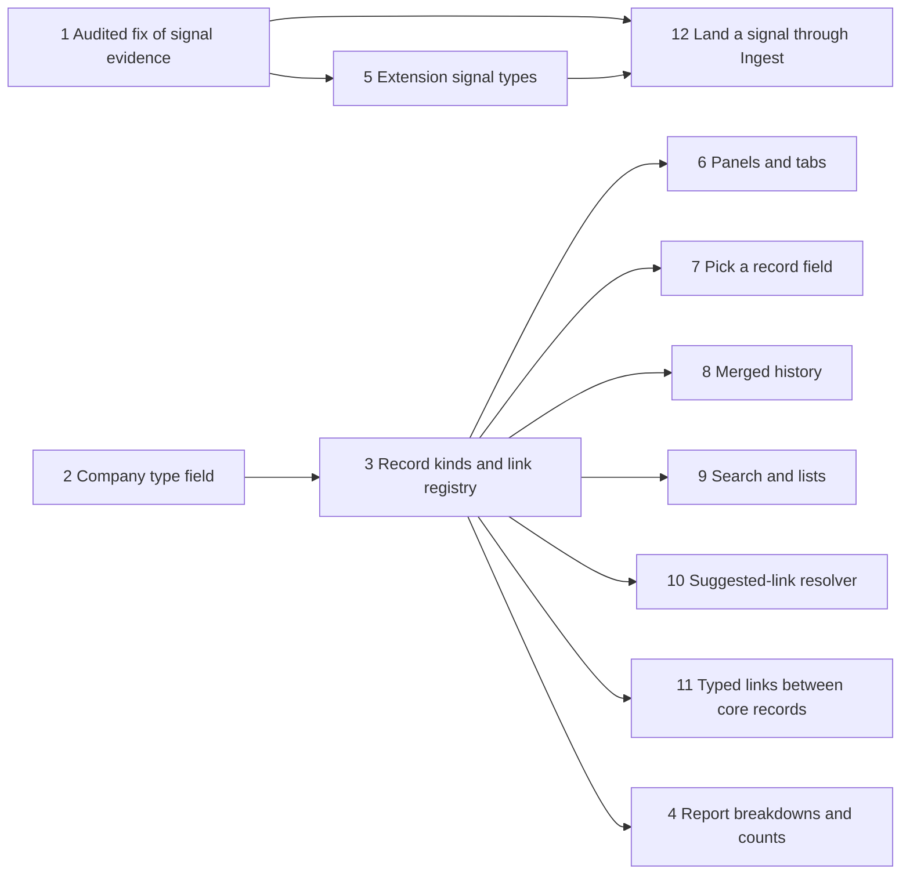

# An extension cannot add its own record kinds, links, signals or reports

This package of work lets an extension bring its own record kinds, links between records, signals and reports into
Margince. It is for those who build or run extensions. Each feature ships on its own, and the table says which ones
are done.

## How to read this page

| Column | Meaning |
|---|---|
| **Feature** | One piece of the package, in build order. |
| **What someone can do now** | What works today. A planned feature says nothing yet. |
| **Page with the details** | Where the facts are. |
| **State** | **done** is built and merged. **planned** has not started. |

| # | Feature | What someone can do now | Page with the details | State |
|---|---|---|---|---|
| 1 | Audited fix of signal evidence | Correct a signal's type and evidence. The old values stay in the audit log. | [Audited fix of signal evidence](#audited-fix-of-signal-evidence) | done |
| 2 | Company type field | Declare a company type in an extension and set it on a company. See it in the company list and filter by it. | [Company type field](#company-type-field) | done |
| 3 | Extension record kinds and link registry | Nothing yet. | None yet | planned |
| 4 | Extension report breakdowns and counts | Nothing yet. | None yet | planned |
| 5 | Extension signal types with structured evidence | Nothing yet. | None yet | planned |
| 6 | Panels and tabs on record pages | Nothing yet. | None yet | planned |
| 7 | "Pick a record" field type | Nothing yet. | None yet | planned |
| 8 | Record page with merged history for extension kinds | Nothing yet. | None yet | planned |
| 9 | Search and lists for extension kinds | Nothing yet. | None yet | planned |
| 10 | Suggested-link resolver | Nothing yet. | None yet | planned |
| 11 | Typed links between core records | Nothing yet. | None yet | planned |
| 12 | Let an unattended extension run land a signal through Ingest | Nothing yet. | None yet | planned |

## Audited fix of signal evidence

A signal can be corrected after it is filed. `PATCH /v1/signals/{id}` now accepts `kind` and `evidence` next to
`status`, `note` and `severity`. The request is `UpdateSignalRequest` in `backend/api/crm.yaml`.

| Field | What it does |
|---|---|
| `kind` | Changes the signal's type. Only the six kinds filed by hand are accepted: `stalled_deal`, `champion_left`, `reengagement`, `buying_intent`, `risk` and `other`. |
| `evidence` | Replaces the whole evidence list. |

The edit uses the existing `update` audit action, so no new action exists. The audit row's before image holds the old
kind and evidence, and its after image holds the new ones. An edit that changes nothing writes no audit row.

The old values live only in that audit row. The audit log view shows them to a user who may read it.
An erasure of a contact writes an erase row against each signal about that contact. The history views then hold back
every image written before that row, so the old kind and evidence are no longer served.
The data-access export for a contact does not list signals, so these old values are not in it yet.

The request contract accepts only those six kinds. The store also accepts the signal's current `kind` unchanged, even
when it is outside the six, so a client can send back what it read. Any other change of `kind` is refused with a 422 on
the field `kind`, code `invalid_kind`, and nothing changes. The maintainers decide which of the other signal kinds may be
corrected. Until then they are refused.

## Company type field

An extension can add company types beside core's fixed list. The steps to declare and set one are in
[Declare a company type](../how-to/add-an-extension.md#declare-a-company-type).

The extension's types live in their own field, `extension_relationship_types`, and core's `relationship_types` list
is unchanged. A published list that grows cannot be narrowed again, and a client that switches on the old list would
meet a value it never saw. The list filter follows the same split. The two fields share one table, so one company can
carry both.

| Part | What it does |
|---|---|
| Value | `ext:<unit>:<type>`, built from the declaring unit's name. A unit cannot set another unit's value. |
| `Extension.CompanyTypes` | The unit declares the types and a label for each. The boot refuses a bad name or a duplicate. |
| `SetExtensionTypes` | The unit sets its own types on a company. It leaves other units' types alone. |
| `PATCH /v1/companies/{id}` | A user or an agent sets `extension_relationship_types`. A value no unit declares is a 422 with the code `invalid_enum`. |
| `GET /v1/company-types` | Lists every declared value and its label, for any signed-in user. |
| `extension_relationship_type` list filter | Takes a declared extension value. The `relationship_type` filter stays core's closed list, because narrowing a published parameter later breaks clients. |
| Agent tools | The company update shape carries `extension_relationship_types`, the same as the REST body. |

`partner` works as before: it needs a partner row, and removing it while a partner row exists is a 422. Setting an
extension type does not touch it. The database check on `company_relationship_type` accepts the shape
`ext:<unit>:<type>`; which pairs exist is decided by the composed set, not by the database.
