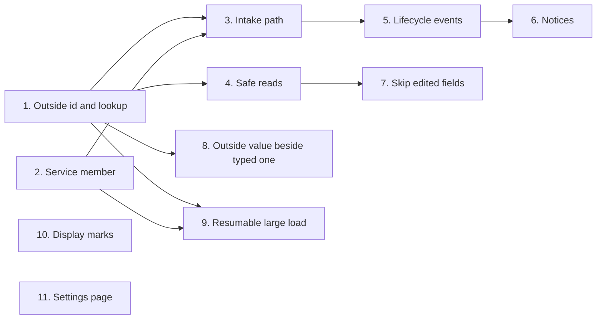

<!-- prose:plain -->
# How extensions reach core data

An extension is a separate unit under `extensions/` that adds to Margince. This package of features gives an extension safe ways to add records, read them, and be told when they change. The table shows which features are built.

## The features

| Feature | What someone can do now | Details | State |
|---|---|---|---|
| 1. Outside-id storage and lookup | Keep the id a contact, company, deal or project has in another system. Find a company or deal by it. | [rest-api.md](rest-api.md#an-id-from-your-system) | done |
| 2. Service member for timed jobs | Make an account that nobody signs in as, keep the secret of a timed job under it, and add records as it. A user who leaves does not stop the job. | [declare-a-service-member.md](../how-to/declare-a-service-member.md) | done |
| 3. Intake path for deals and companies | Send a company or a deal with the id it has in the system it came from. A company typed by hand is matched by its domain. A deal can change stage, and activities can be moved onto the record. | [land-companies-and-deals-from-an-extension.md](../how-to/land-companies-and-deals-from-an-extension.md) | done |
| 4. `Read doors for core records` | Read deals, companies, signals, activities and the custom-field list as the caller who made the call. Filter by custom-field value and by the outside id. Each list is audited as an export. | [read-core-records-from-an-extension.md](../how-to/read-core-records-from-an-extension.md) | done |
| 5. `Record lifecycle events` | Listen for `company.erased`, `deal.erased` and `deal.merged`. Each carries ids only. The shape of a read of an erased id, id and kind only, is declared as `Tombstone`, but no read returns it yet. Core publishes the events once it has the erase and merge operations. | [react-to-record-lifecycle-events.md](../how-to/react-to-record-lifecycle-events.md) | done |
| 6. `Notices door` | Send a notice about a contact, company or deal to a member or a role. The extension names no address. The core finds live members who can open the record and picks the channel. The notice holds a link, not a copy of the record. Capped per extension. A notice started by a scheduled job is refused for now. | [send-a-notice-from-an-extension.md](../how-to/send-a-notice-from-an-extension.md) | done |
| 7. Skip fields a user edited | An extension that updates a company or deal leaves alone a field a user last edited, and the result names the fields it left alone. A deal's amount and currency are always left alone together. An admin can let one extension overwrite them instead, under Settings, Extensions, or with `PUT /v1/extensions/{name}/settings`. The setting is off by default and each change is audited. | [land-companies-and-deals-from-an-extension.md](../how-to/land-companies-and-deals-from-an-extension.md) | done |
| 8. Keep the outside value beside the typed one | Not yet. Both values will stay on the record. | | planned |
| 9. `Bulk load that can resume` | Not yet. A large load will carry on after a stop. | | planned |
| 10. `Extra display marks on core records` | Not yet. An extension will add marks to a record. | | planned |
| 11. Per-extension settings page | Not yet. Each extension will have its own settings page. | | planned |

## How the features connect

## How to read this page

Done means the feature is built and the linked page describes it. Planned means it is not built yet.

The reasons behind feature 1 are in [outside-ids.md](../explanation/outside-ids.md).
