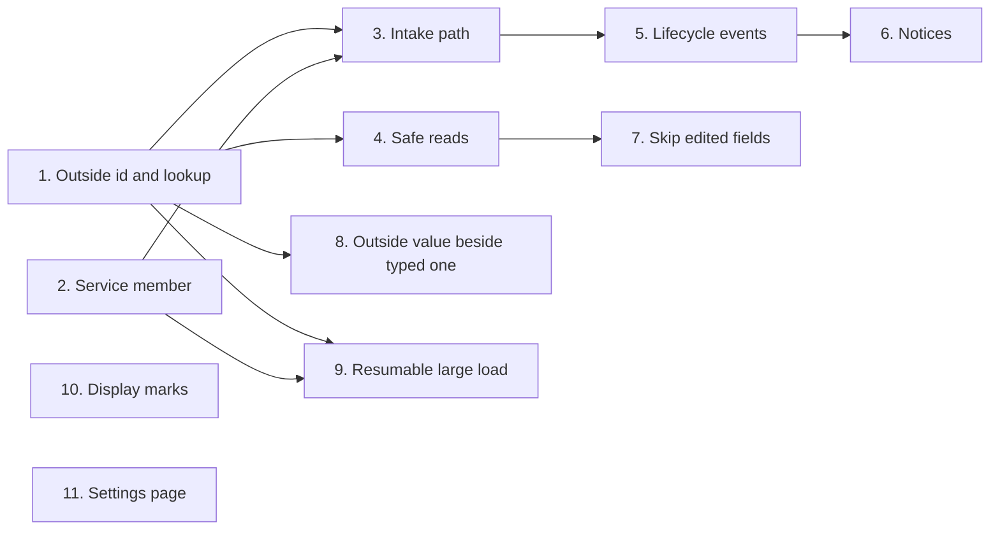

<!-- prose:plain -->
# How extensions reach core data

An extension is a separate unit under `extensions/` that adds to Margince. This package of features gives an extension safe ways to add records, read them, and be told when they change. The table shows which features are built.

## The features

| Feature | What someone can do now | Details | State |
|---|---|---|---|
| 1. Outside-id storage and lookup | Keep the id a contact, company, deal or project has in another system. Find a company or deal by it. | [rest-api.md](rest-api.md#an-id-from-your-system) | done |
| 2. `Service member for unattended feeds` | Not yet. A job that runs with no user at the keyboard will have its own member. | | planned |
| 3. Intake path for deals and companies | Not yet. One path will create records. | | planned |
| 4. `Read doors for core records` | Not yet. An extension will read core records in a safe way. | | planned |
| 5. `Record lifecycle events` | Not yet. An extension will be told when a record is created or changed. | | planned |
| 6. `Notices door` | Not yet. An extension will send a notice to the user. | | planned |
| 7. Skip fields a user edited | Not yet. A job will leave alone what a user typed. | | planned |
| 8. Keep the outside value beside the typed one | Not yet. Both values will stay on the record. | | planned |
| 9. `Bulk load that can resume` | Not yet. A large load will carry on after a stop. | | planned |
| 10. `Extra display marks on core records` | Not yet. An extension will add marks to a record. | | planned |
| 11. Per-extension settings page | Not yet. Each extension will have its own settings page. | | planned |

## How the features connect

## How to read this page

Done means the feature is built and the linked page describes it. Planned means it is not built yet.

The reasons behind feature 1 are in [outside-ids.md](../explanation/outside-ids.md).
