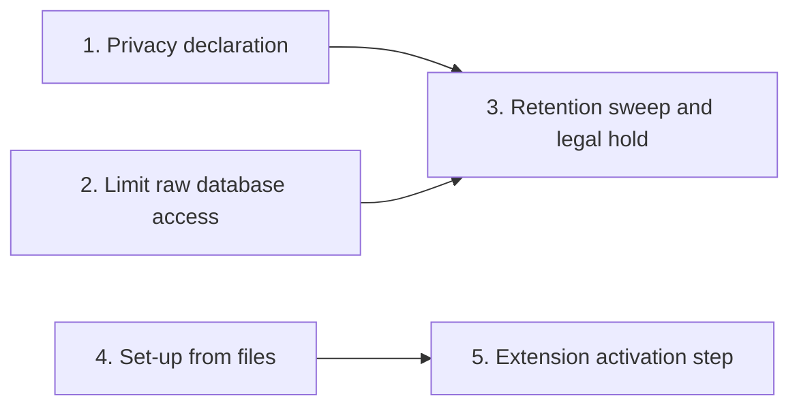

<!-- prose:plain -->
# Extension privacy and retention

An extension keeps its own tables. This page tracks the five features that make the data in those tables
follow the same privacy and retention rules as core data. It is for those who build or run Margince.

Extension data follows core's rules in three steps. An extension declares what personal data it holds, so
core can clear, export and guard it. Its raw SQL reaches only its own tables, so core's records change only
through core's own verbs. Core then applies retention and legal hold to the declared data.

## The features

| Feature | What someone can do now | Page with the details | State |
|---|---|---|---|
| 1. Privacy declaration for extension data | Declare each table's personal data. Core clears, exports and guards it. | [Add an extension](../how-to/add-an-extension.md#declare-the-personal-data-in-your-tables) and [privacy and consent](../explanation/privacy-and-consent.md#extension-tables) | Done |
| 2. Limit raw database access | Run SQL in `Tx` on the extension's own tables only. A core table is refused with `ErrCoreTableRefused`; core records are reached through `Tx.Core()`, the read calls and `Ingest`. | [Add an extension](../how-to/add-an-extension.md) and [what the tier does not guard against](../explanation/extensibility.md#what-the-tier-does-not-guard-against) | Done |
| 3. Retention sweep and legal hold | Name a date column in the declaration. A `retention_policy` row for `extension/<table>` then makes core delete old rows, but never a row inside its retention class floor. Hold a row, and release the hold. A hold blocks erasure and the sweep. Core writes the audit entries and events. | [Privacy and consent](../explanation/privacy-and-consent.md#extension-tables) and [Add an extension](../how-to/add-an-extension.md#declare-the-personal-data-in-your-tables) | Done |
| 4. Set-up from files | Ship the unit's settings in `settings.json`. An operator runs `migrate extension-settings` to store them once under `ext_<name>.<key>` (each hyphen in the name becomes `_`), with no signed-in member. A second run changes nothing. The unit's code cannot read them yet. | [Add an extension](../how-to/add-an-extension.md#ship-the-units-settings-in-a-file) and [configuration](../reference/configuration.md#cmdmigrate-schema-migrations) | Done |
| 5. Extension activation step | Add the folder; the next boot stores the unit's settings, gives the admin role its RBAC objects with an audit row each, and marks the unit Ready on the Extensions page. Remove the folder; the next boot revokes every secret the unit held. | [Add an extension](../how-to/add-an-extension.md#what-boot-does-for-a-new-unit) | Done, except the service-member identity |

## How the features connect

## What feature 2 leaves open

All extensions share one database role, `ext_runtime`. It holds the whole `ext` schema, so one extension can
still read the tables of another. A role for each extension would close that and is not asked for here.
The role also does not stop a unit that means harm, because an extension runs in the same process as core. A statement that
ends in another role is caught, and nothing it did is kept. One that switches to another role and back inside itself stays hidden.

## What feature 3 leaves open

The settings screen and the retention policy API list a fixed set of scopes. The scope of an extension
table is the table's own name. So a policy row for `extension/<table>` is added to `retention_policy`
directly, and none exists by default. A core rule that strips a contact of its name keeps the contact while
one of its extension rows is held. It picks the contact again on each pass.

## What feature 4 leaves open

Core stores the seeded values and does not yet hand them to the unit's code. A unit has no `Runtime` call that
reads them, and its database role cannot reach the `setting` table. The settings screen does not list them either.

## What feature 5 leaves open

A unit does not get a service-member identity at install. That code is on another track and joins this step
when it lands. The unit's own code still cannot read its seeded settings (see feature 4). Other roles hold a
unit's rights only after an admin grants them.

## How to read this page

**Done** means the feature is in the code and its page is linked. Where a part is named after it, that part is
not built. **Planned** means it is not built. A line in the chart
means the feature on the left is needed by the feature on the right.
