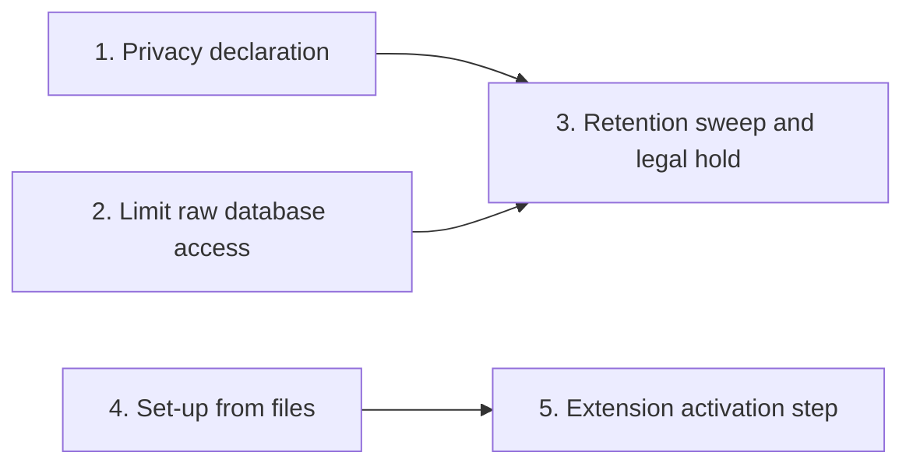

<!-- prose:plain -->
# Extension privacy and retention

An extension keeps its own tables. This page tracks the five features that make the data in those tables
follow the same privacy and retention rules as core data. It is for those who build or run Margince.

Extension data follows core's rules in three steps. An extension declares what personal data it holds, so
core can clear, export and guard it. Its raw SQL reaches only its own tables, so core's records change only
through core's own verbs. Core will then apply retention and legal hold to the declared data.

## The features

| Feature | What someone can do now | Page with the details | State |
|---|---|---|---|
| 1. Privacy declaration for extension data | Declare each table's personal data. Core clears, exports and guards it. | [Add an extension](../how-to/add-an-extension.md#declare-the-personal-data-in-your-tables) and [privacy and consent](../explanation/privacy-and-consent.md#extension-tables) | Done |
| 2. Limit raw database access | Run SQL in `Tx` on the extension's own tables only. A core table is refused with `ErrCoreTableRefused`; core records are reached through `Tx.Core()`, the read calls and `Ingest`. | [Add an extension](../how-to/add-an-extension.md) and [what the tier does not guard against](../explanation/extensibility.md#what-the-tier-does-not-guard-against) | Done |
| 3. Retention sweep and legal hold | Nothing yet. | None yet | Planned |
| 4. Set-up from files | Nothing yet. | None yet | Planned |
| 5. Extension activation step | Nothing yet. | None yet | Planned |

## How the features connect

## What feature 2 leaves open

All extensions share one database role, `ext_runtime`. It holds the whole `ext` schema, so one extension can
still read the tables of another. A role for each extension would close that and is not asked for here.
The role also does not stop a unit that means harm, because an extension runs in the same process as core. A statement that
ends in another role is caught, and nothing it did is kept. One that switches to another role and back inside itself stays hidden.

## How to read this page

**Done** means the feature is in the code and its page is linked. **Planned** means it is not built. A line in the chart
means the feature on the left is needed by the feature on the right.
