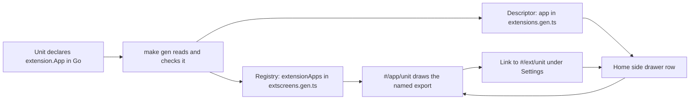

# Extensions as apps in the home side drawer

This package lets an extension appear as an app in the home side drawer, with its own icon and name. Before, a
unit's screen was only reachable under Settings. Now a unit can declare one app, and the drawer lists it for
every reader who may use it. This page is for anyone who builds an extension or reviews one, and it lists each
feature of the package with the page that has the details.

## Which page do you need?

| Feature | What someone can do now | The page with the details | State |
|---|---|---|---|
| 1. Extensions can appear as apps in the home side drawer with their own icon, not only under Settings | A unit declares an `extension.App`. Readers with `read` on its object see a drawer row and open the app at `#/app/<unit>`. The sub-setting stays at `#/ext/<unit>` | [add-an-extension.md](../how-to/add-an-extension.md#show-an-app-in-the-home-side-drawer) and [extension-apps-in-the-drawer.md](../explanation/extension-apps-in-the-drawer.md) | Done |

## How the feature connects

The same checks run again when the server starts, so a hand-built unit cannot skip them.

## How to read this page

| Mark | Meaning |
|---|---|
| **Done** in the State column | The feature is in the tree, with tests |
| **Planned** in the State column | The feature is named but not built |
| **#/app/unit** | The address of a unit's app, with the unit's name in place of `unit` |
| **#/ext/unit** | The address of a unit's sub-setting under Settings |
