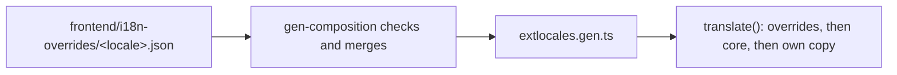

# Extensions can override core's translations

This package of work lets an extension replace core's wording, per language, so an installation can tailor what its
screens say without forking core. It is for those who build or run extensions. The table lists each feature and the
page with its details.

## How to read this page

| Column | Meaning |
|---|---|
| **Feature** | One piece of the package, in build order. |
| **What someone can do now** | What the feature gives an extension author. |
| **Page with the details** | Where the facts are. |
| **State** | `done` is built and merged into the package branch. `planned` is not built yet. |

| # | Feature | What someone can do now | Page with the details | State |
|---|---|---|---|---|
| 1 | Extensions can override core's translations so wording can be tailored per installation | Ship `frontend/i18n-overrides/<locale>.json` with core keys. The build merges them, refuses an unknown key or two units on one key, and the screens show the new wording. | [Override core wording](../how-to/add-an-extension.md#override-core-wording) | done |

