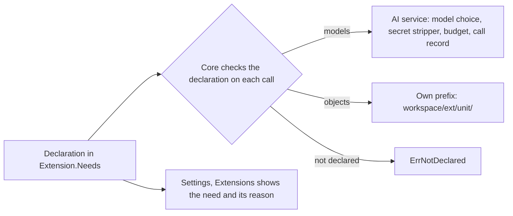

<!-- prose:plain -->
# Extensions that use the core's AI models and file store

An extension can ask the core to call an AI model for it and to keep files for it. It must declare each need in its manifest, and the core refuses everything it did not declare. The admin who installs the extension sees each declared need with the author's reason. The table shows which features are built.

## The features

| Feature | What someone can do now | Details | State |
|---|---|---|---|
| 1. Needs granted by declaration | Declare `models` and `objects` in `Extension.Needs`, each with a reason. Call `Models().Complete` and store, read and delete files under the unit's own key prefix. Any other call returns `ErrNotDeclared`. An admin reads the needs under Settings, Extensions. | [extension-capabilities.md](extension-capabilities.md) | done |

## How the features connect

## How to read this page

Done means the feature is built and the linked page describes it. Planned means it is not built yet. The reasons for the design are in [extension-capability-grants.md](../explanation/extension-capability-grants.md).
