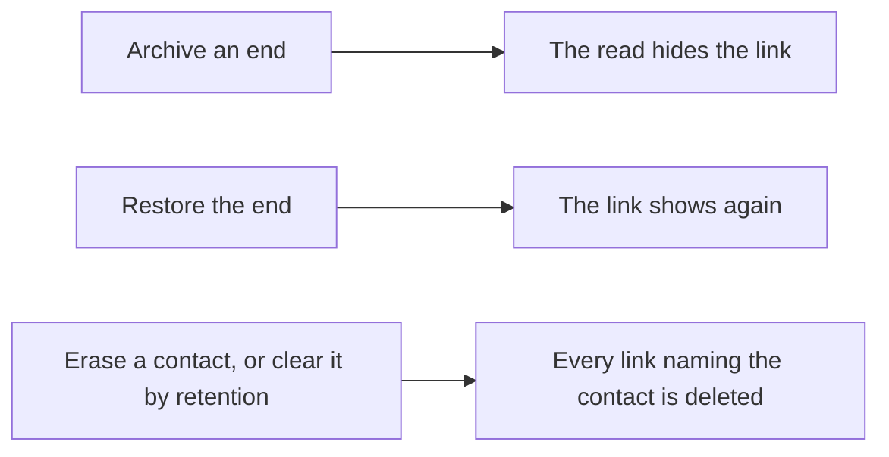

<!-- prose:plain -->
<!-- describes: backend/internal/modules/recordlinks backend/internal/shared/ports/recordkinds/linktypes.go backend/pkg/extension/linktype.go backend/internal/platform/database/storekit/deallinks.go -->
# Typed links between records

A typed link joins two core records and names how they are tied. This page is for those who build or run Margince. It
lists the link types, the rights, the routes and what happens to a link when a record is archived or erased. The
steps to declare a type in an extension are in [Declare a link type](../how-to/add-an-extension.md#declare-a-link-type).
What a user sees is in [Links between records](../handbook/deal-links.md).

## How to read this page

| Word | Meaning |
|---|---|
| **From** | The record the link starts on. A follow-up deal is the *from* end of `follow_up_of`. |
| **To** | The record the link ends on. |
| **Type** | A core word, or `ext:<unit>:<type>` for an extension's. |

## The link

One row in `record_link` holds the two ends and the type. The ends are `deal`, `company` or `contact`. The same pair can
hold several types, and the reverse of a pair is a different link. A link to itself is refused. A pair that already holds
the type is the same success and writes nothing.

## The types

One registry holds every type, and the record kinds live in it too (`recordkinds`). Core's types are always there.

| Type | Declared by | Joins |
|---|---|---|
| `follow_up_of` | core | any two of the three |
| `renews` | core | any two of the three |
| `related_to` | core | any two of the three |
| `ext:<unit>:<type>` | an extension, in `Extension.LinkTypes` | the ends the unit names, or all three |

The boot refuses a bad name, a missing label, an end that is not one of the three, and a type a unit declares twice.
`GET /v1/link-types` lists them with their ends.

## Rights

| Action | What the caller needs |
|---|---|
| Make a link | The `update` right on the type of the *from* record and write authority over that record. The right to attach to the *to* record, and the right to read its type. |
| Remove a link | The same on the *from* record, and the *to* record must be readable. |
| Read the links of a record | The `read` right and a record the caller may open. A link is left out when the caller may not read the other end, or the other end is archived. |

A record the caller cannot open answers not found, so the id is not disclosed. Both ends are locked while the link is
written, so an erasure of a contact waits for it.

## Routes

All routes are human only. No agent tool exists for links.

| Route | What it does |
|---|---|
| `GET /v1/link-types` | Every type, with the ends each allows. |
| `GET /v1/record-links` | The links of one record, from `record_type` and `record_id`, newest first, at most 200. |
| `POST /v1/record-links` | Makes a link. |
| `DELETE /v1/record-links/{id}` | Removes a link. |

Each change writes an audit row on the record the link starts on and the event `record_link.changed`. Both name the link
and its type, and never the other end.

## Archive and erase

Archiving writes nothing to `record_link`. Erasing a contact and the retention clearing both call one function that
deletes the links of that contact in their own transaction.

## Filter and breakdown

| Where | What it does |
|---|---|
| `GET /v1/deals?link_type=` | Keeps the deals that hold a link of that type to another live deal, from either end. |
| Report split `link_type` | Groups deals by the sorted set of link types they hold with other live deals, or `none`. An extension breakdown may split its deals by it. |

Both read links between deals only, so the deal read right covers both ends. Links to a company or a contact show on the
deal page and are not read by the filter or the breakdown.

## What is not done

A merge of two records does not move the links of the record that is merged into the other. The links stay on it and are hidden
while it is archived.
